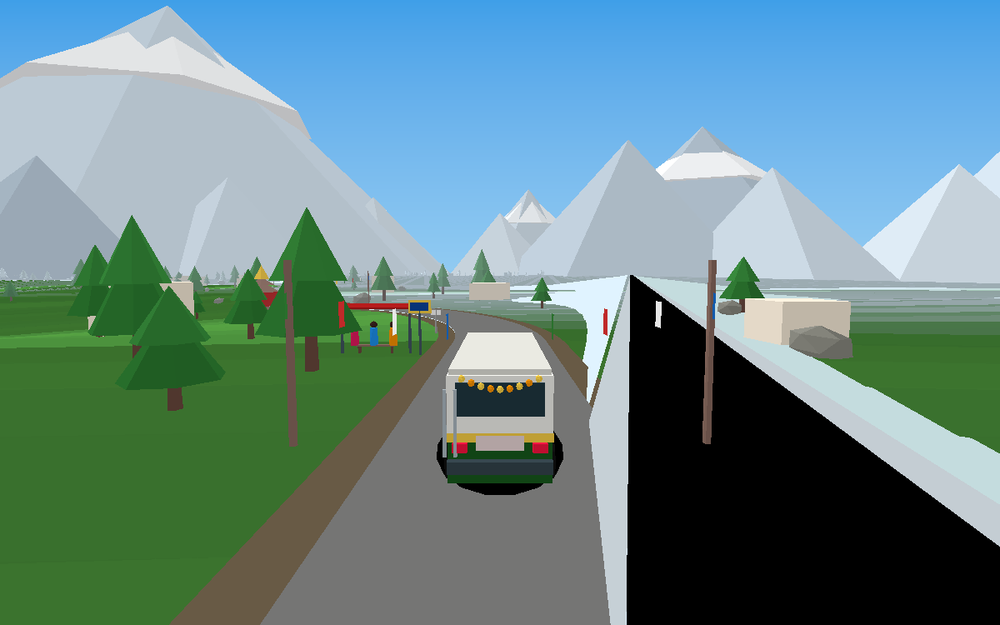
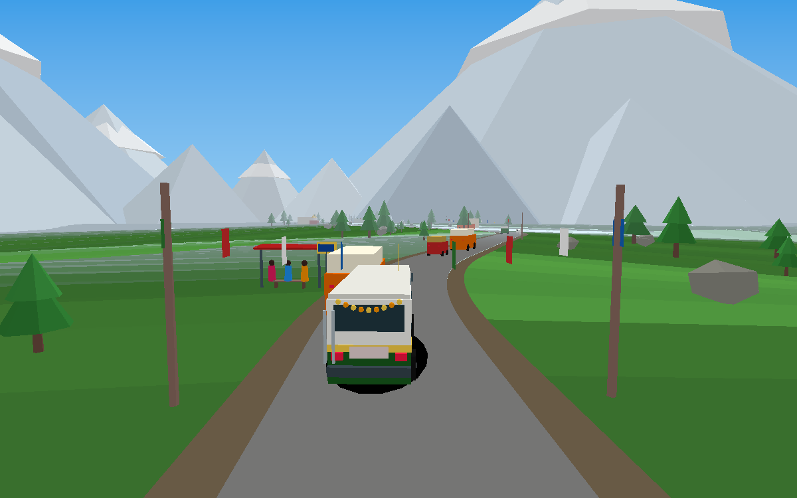

# 🚌 S.ROCKET — Nepali Bus Simulator (3D)

A **real 3D** Nepali bus simulator — three.js (WebGL) wrapped in a tiny Android app, so it
installs on a phone as a normal **APK**. Same repo also runs in a desktop browser.

> हिमालयको बाटोमा ताता बस चलाउनुहोस् 🏔️




<sub>The two frames above are rendered by the project's offline verification rasteriser (a
software z-buffer that draws the real three.js scene, since CI has no GPU). On a phone the
same scene runs through WebGL with proper lighting and lane markings.</sub>

---

## 📲 Install the APK (Android)

1. On your phone open:
   **[S.Rocket-Bus-Sim.apk](https://raw.githubusercontent.com/kushaladhikari982648-lgtm/S.rocket/arena/75781f06-s-rocket/dist/S.Rocket-Bus-Sim.apk)**
   (or grab it from the repo's `dist/` folder / the latest *Build Android APK* run).
2. Chrome will ask **"Download anyway?"** → Download.
3. Tap the downloaded file → Android asks to allow installs from this source → **Allow**
   (Settings ▸ Apps ▸ Special access ▸ Install unknown apps ▸ Chrome).
4. Open **S.Rocket Bus** from your launcher. That's it — works fully offline, no permissions,
   no ads, no internet needed.

Requirements: Android 6.0+ (API 23) with a GPU that supports OpenGL ES 2.0 (any phone since ~2013).
The APK is only **~180 KB** — the whole game is code plus textures drawn at runtime, no image/audio files.

## 🎮 How to play

**Touch (phone):** ◀ ▶ steer · ▲ gas · ▼ brake · 📯 horn · 🚪 door.
The buttons appear automatically on touch devices.

**Keyboard (desktop):** `W`/`↑` gas · `S`/`↓`/`Space` brake · `A`/`D` or `←`/`→` steer ·
`H` horn · `E` open/close door · `F` refuel at a pump · `P` pause · `M` mute · `C` camera.

### The loop

- **Stop fully** at a 🚏 bus stop → the door button lights up → press it: passengers get off,
  new ones board and you earn the fare (रू 40–120 each, 40 seats).
- **Horn** makes cows amble off the road (and it looks cool) — *HORN OK PLEASE!*
- **F** refuels at a ⛽ petrol pump (रू 3 per %) — you must be stopped.
- Crashes cost damage (100 % = run over), the clock is the real enemy: reach the last stop
  in time for a star rating, a rank and a time bonus.

### Routes

| Route | Terrain | Stops | Difficulty |
|---|---|---|---|
| काठमाडौं → पोखरा | Hilly highway, blind curves, river gorges | Thankot, Naubise, Malekhu, Muglin, Dumre | ⭐⭐ |
| विराटनगर → वीरगञ्ज | Flat Terai, trucks, cows, paddy fields | Itahari, Janakpur, Hetauda | ⭐ |
| बागलुङ → जोमसोम | Mustang mountain road, snow peaks, prayer flags | Beni, Tatopani, Jomsom, Muktinath | ⭐⭐⭐ |

## 🧱 What's inside (all real 3D, no sprites)

- **Track**: seeded procedural road (S-bends, climbs, hairpins) sampled every 2 m into typed
  arrays, with arc-length lookup — the bus follows the actual 3D curve, and a chase camera
  tracks it (FOV widens in portrait).
- **Geometry**: extruded road + shoulders, wobbly terrain skirt, three HUD-less sky domes,
  low-poly Himalayan ranges with snow caps and heat-haze tinting.
- **Instancing / merging for mobile**: trees, rocks, cows, vans are `InstancedMesh`;
  temples, gates, km-posts, shelters, pumps are merged into single vertex-coloured meshes —
  the whole track is ~40 k triangles in a handful of draw calls.
- **Cheap materials**: MeshLambert (no shadows, no post-processing), procedural
  `CanvasTexture` asphalt with lane markings, device-pixel-ratio capped at 1.75, one fog pass.
- **Procedural audio** (WebAudio, no audio files): engine that follows speed, horn, door bell,
  cash register, crash.
- **HUD** in Nepali + English: speedometer with gear, fuel/damage bars, earnings, passenger
  count, route progress with stop dots, next-stop banner.

## 🛠 Build it yourself

```bash
npm install                 # three + esbuild
npm run build               # src/game.js  ->  game.js (minified IIFE bundle, ~535 KB)
python3 -m http.server 8000 # open http://localhost:8000 (desktop / browser test)
```

### Build the APK

The Android shell lives in `android/` — a dependency-free `Activity` + `WebView`
(no AndroidX, no ads SDK, no analytics). It copies `index.html` + `game.js` into the APK
assets at build time.

```bash
# needs JDK 17 + Android SDK 34
gradle -p android assembleDebug
# -> android/app/build/outputs/apk/debug/app-debug.apk
```

Or just push: `.github/workflows/build-apk.yml` builds the debug APK on GitHub Actions and
uploads it as the `s-rocket-apk` artifact.

```
src/game.js          game source (three.js, ES modules)
game.js              built bundle loaded by index.html
index.html           HUD, menus, touch controls (inline CSS, no external assets)
android/             WebView wrapper + manifest + vector launcher icon
.github/workflows/   APK build CI
```

Made with 🚀 for fun. जय नेपाल 🇳🇵
